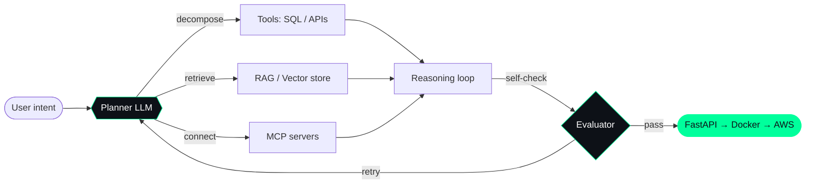

  

<h3 align="center">AI / ML Engineer · Generative AI & Agentic Systems on AWS ⚡</h3>

  

  
  
  

---

## 👨‍💻 About Me

- 💼 **AI / ML Engineer** with 6+ years across software, data and ML engineering, including 3+ years taking Generative AI from prototype to production
- 🎯 Recently completed **MS in Data Science at University of Connecticut **, Connecticut (May 2024)
- 🥇 **3x Hackathon Winner:** Columbia Get Hired Hack 2026 (1st of 50 teams) · HackRU 2025 (1st of 450+ participants) · Top 5 of 200 teams at Barclays Data Stellar 2023 (team lead)
- 👨‍🏫 Worked as a **Teaching Assistant at UCONN**, teaching Database Management, Web Development and Discrete Structures
- 🌱 Currently exploring **multi-agent systems, Agentic Ops and cloud infrastructure**
- 🎯 Looking for **full-time opportunities in 2026**

---

## 💻 Tech Stack

**🔤 Languages**

  
  
  
  

**🎨 Frontend**

  
  
  
  
  
  

**⚙️ Backend**

  
  
  
  
  

**🗄️ Databases**

  
  
  
  
  
  
  
  
  

**🤖 Traditional AI / ML**

  
  
  
  
  
  
  

**🧠 Agentic AI / Gen AI**

  
  
  
  
  
  
  
  
  

**☁️ DevOps & Cloud**

  
  
  
  
  
  
  
  
  
  

**🛠️ Tools & Platforms**

  
  
  
  
  
  
  
  

---

## 🎯 Areas of Interest

  
  
  
  
  
  
  

---

## 🧠 How I Build Agents

---

## 🚀 Featured Projects

<table>
<tr>
<td width="50%" valign="top">

#### 📊 [Agentic Analytics](https://github.com/ShubhamRSY/Agentic-Analytics)
Ask questions in plain English, get answers from your data. AI agents that plan, query, and explain analytics.

  

</td>
<td width="50%" valign="top">

#### 🌐 [Portfolio](https://github.com/ShubhamRSY/shubham.portfolio)
Projects, skills and experience in one place.

 

</td>
</tr>
</table>

---

## 📡 GitHub Activity

  

  

---

## 🤝 Let's Connect!

I'm always eager to connect with like-minded professionals and explore opportunities in the tech industry. Feel free to reach out for collaborations or discussions about:

- 🤖 Machine Learning & AI
- 🧠 Agentic AI & LLM Systems
- 💻 Full Stack Development
- ⚙️ Software Engineering
- 🎓 Academic Research
- 👨‍🏫 Teaching & Mentoring

  
  
  

  

