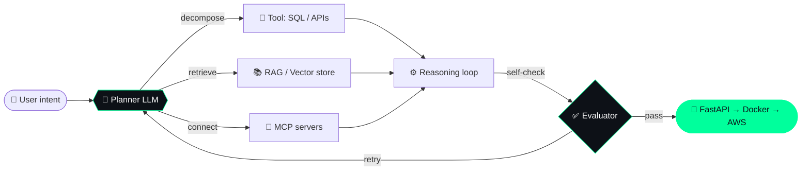

<!-- ═══════════════ HEADER ═══════════════ -->
<p align="center">
  
</p>

<p align="center">
  
</p>

<p align="center">
  <a href="https://www.linkedin.com/in/shubham-yedekar-8a2a141b7/"></a>
  
</p>

---

### `$ cat whoami.py`

```python
from dataclasses import dataclass, field

@dataclass
class Agent:
    name: str = "Shubham Yedekar"
    role: tuple = ("ML Engineer", "Agentic AI Developer")
    system_prompt: str = "Turn messy data and vague ideas into AI that actually ships."

    tools: dict = field(default_factory=lambda: {
        "languages":  ["Python", "TypeScript", "SQL"],
        "ml":         ["PyTorch", "TensorFlow", "scikit-learn"],
        "agents":     ["LangChain", "MCP", "tool-calling LLMs"],
        "backend":    ["FastAPI", "Docker"],
        "cloud":      ["AWS", "Linux"],
    })

    memory: list = field(default_factory=lambda: [
        "currently_exploring -> multi-agent systems & Model Context Protocol",
        "currently_building  -> agentic analytics pipelines",
        "always_learning     -> scalable, production-grade AI infra",
    ])

    def run(self, problem):
        return self.plan(problem) | self.act() | self.evaluate() | self.ship()

me = Agent()
```

---

### 🧠 How I build agents



---

### 🧰 Toolbox

<p align="center">
  
</p>

---

### 🚀 Featured builds

<table>
<tr>
<td width="50%" valign="top">

#### 📊 [Agentic Analytics](https://github.com/ShubhamRSY/Agentic-Analytics)
Ask questions in plain English, get answers from your data. AI agents that plan, query, and explain analytics.

`Python` `LLMs` `Agents` `Data`

</td>
<td width="50%" valign="top">

#### 🌐 [Portfolio](https://github.com/ShubhamRSY/shubham.portfolio)
Projects, skills and experience in one place.

`Web` `Portfolio`

</td>
</tr>
</table>

<details>
<summary><b>🔭 What's in my lab right now (click to expand)</b></summary>
<br>

| Status | Experiment |
|:--:|---|
| 🟢 | Multi-agent orchestration with tool calling |
| 🟡 | Building custom MCP servers for data sources |
| 🟡 | Evaluating LLM outputs with automated judges |
| ⚪ | Next idea loading... |

</details>

---

### 📡 Activity

<p align="center">
  
</p>

<p align="center">
  
</p>

---

<p align="center">
  <code>&gt; agent.status → open to collaborate on AI, agents & data projects</code>
</p>

<p align="center">
  
</p>
